# ANDROID PROCESS, PERMISSION, AND VULNERABILITY MANAGER (APVM)

## 1. Project Overview & Executive Summary

The **Android Process, Permission, and Vulnerability Manager (APVM)** is an Android cybersecurity application designed to provide a centralized platform for monitoring application processes, auditing application permissions, and identifying security vulnerabilities in Android applications.

Traditional Android security utilities often provide isolated functionality such as viewing application permissions, monitoring running applications, or performing APK analysis. APVM combines these capabilities into a single security-oriented platform.

The system provides seven major modules:

1. Security Dashboard
2. Android Process Manager
3. Permission Auditor
4. APK Security & Vulnerability Scanner
5. Security Risk Assessment
6. Security Report & Explanation
7. Scan History

The platform analyzes installed applications and user-selected APK files, identifies potentially risky permissions and insecure application configurations, evaluates detected security findings, and presents the results through understandable security reports.

APVM focuses primarily on **Android application security assessment, process monitoring, permission auditing, and static APK vulnerability analysis**.

---

# 2. Core Objectives

The primary objectives of APVM are:

- Provide a centralized security dashboard for Android applications.
- Monitor currently running application processes.
- Provide supported process-management capabilities.
- Audit permissions requested by installed applications.
- Identify dangerous and special-access permissions.
- Analyze APK files for insecure configurations and known vulnerability patterns.
- Identify exposed Android application components.
- Assign an overall security risk level.
- Explain security findings in an understandable manner.
- Maintain a history of previous APK security scans.

---

# 3. System Architecture

APVM is built as a 100% native on-device Android application using Kotlin, Jetpack Compose, and Room Database. All permission classification, APK manifest analysis, and risk scoring execute locally without external network dependencies or remote backend services.

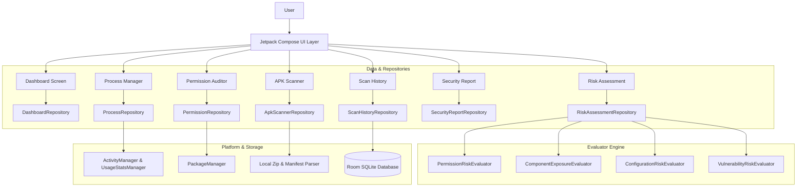

---

# 4. Security Dashboard

The **Security Dashboard** is the central interface of APVM. It provides a high-level overview of the security state of applications and previously performed analyses.

## Features

- Display the overall device security overview.
- Display the number of installed applications.
- Display the number of currently running processes.
- Display applications using dangerous permissions.
- Display applications using special or potentially suspicious permissions.
- Display the number of detected APK vulnerabilities.
- Display the overall security status.
- Display the overall risk summary.
- Provide quick access to:
  - Android Process Manager
  - Permission Auditor
  - APK Security Scanner
  - Security Reports
  - Scan History
- Highlight applications requiring further security investigation.

## Dashboard Flow

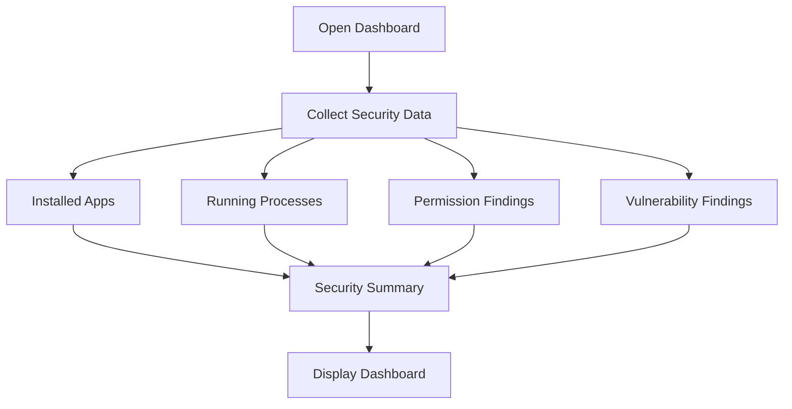

---

# 5. Android Process Manager

The **Android Process Manager** provides information about currently running application processes and provides supported process-management operations.

The module is intended to provide visibility into application activity while respecting Android's security and process-isolation restrictions.

## Process Monitoring

The module can:

- View currently running processes.
- Display process/application name.
- Display Process ID (PID), where available.
- Display process status.
- Display available CPU information.
- Display available memory/resource information.
- Identify the application associated with a process.
- Refresh the process list.
- Display basic process activity information.

## Process Management & Platform Constraints

The Process Manager operates within Android's modern platform security boundary:

- Foreground app detection uses `UsageStatsManager` (requiring user authorization via `Settings.ACTION_USAGE_ACCESS_SETTINGS`).
- Background and running processes are retrieved via `ActivityManager.runningAppProcesses`.
- On Android 11 (API 30) and newer, historical process termination reasons (crashes, ANRs, memory pressure) are retrieved using `ActivityManager.getHistoricalProcessExitReasons`.
- Note: Third-party apps on modern non-rooted Android cannot arbitrary terminate or hibernate other applications due to Linux UID sandboxing. Process management in APVM focuses on observability and diagnostics.

## Process Manager Flow

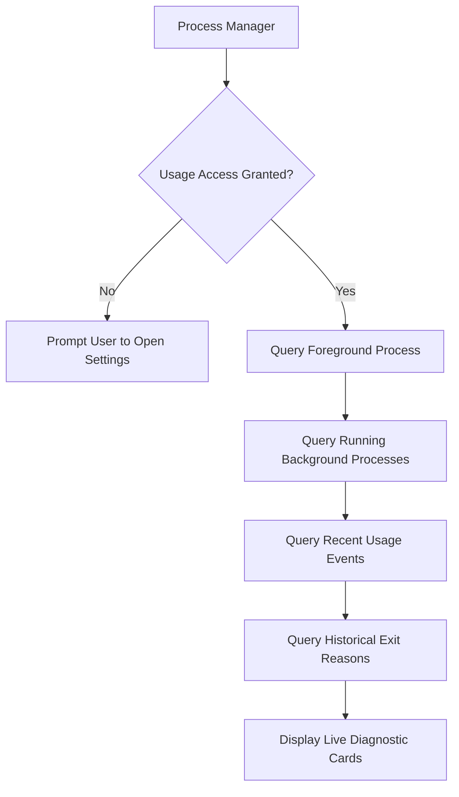

---

# 6. Permission Auditor

The **Permission Auditor** analyzes permissions requested by installed Android applications and categorizes them according to their potential security impact.

The purpose of the module is to provide contextual permission analysis rather than simply displaying a list of permission names.

## Permission Discovery

The module can:

- List permissions requested by installed applications.
- Group permissions by application.
- Display permission names.
- Display permission descriptions where available.
- Display the permission category or protection level.
- Identify permissions requiring special access.

## Permission Classification

Permissions can be classified into:

- Normal permissions
- Dangerous permissions
- Special-access permissions
- Other sensitive or less-obvious permissions

Examples include:

```text
READ_SMS
READ_CALL_LOG
RECORD_AUDIO
ACCESS_FINE_LOCATION
READ_CONTACTS
SYSTEM_ALERT_WINDOW
REQUEST_INSTALL_PACKAGES
```

## Permission Risk Analysis

The module can:

- Detect applications requesting multiple sensitive permissions.
- Identify potentially excessive permission usage.
- Identify special-access permissions.
- Highlight potentially risky permission combinations.
- Compare requested permissions with application functionality where sufficient information is available.
- Explain why a flagged permission may represent a security concern.

A permission alone does not prove that an application is malicious. The permission findings are treated as security indicators that contribute to the overall risk assessment.

## Permission Auditor Flow

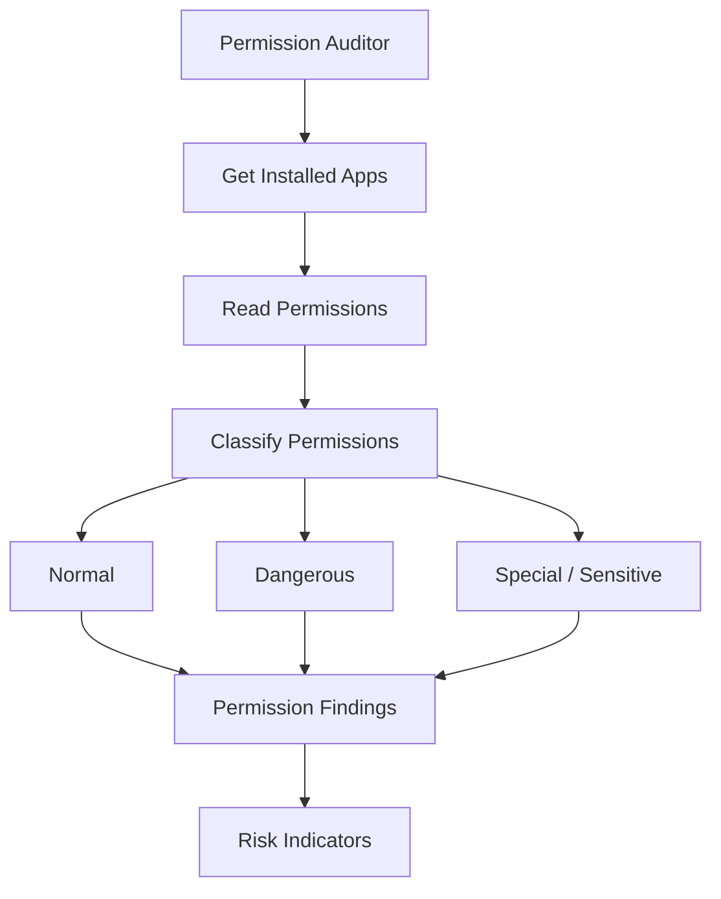

---

# 7. APK Security & Vulnerability Scanner

The **APK Security & Vulnerability Scanner** performs static security analysis on user-selected APK files.

The scanner examines APK metadata, the Android manifest, application components, permissions, and code/resources for known security weaknesses and vulnerable configurations.

## APK Input

The scanner supports:

- APK file selection/import.
- APK metadata extraction.
- Package name identification.
- Application version identification.
- APK structure inspection.

## AndroidManifest.xml Analysis

The scanner analyzes:

- Requested permissions.
- Activities.
- Services.
- Broadcast receivers.
- Content providers.
- Exported components.
- Component protection settings.
- Application configuration.

## Component Security Analysis

The scanner checks for potentially unsafe configurations involving:

### Activities

- Unnecessarily exported activities.
- Missing or weak protection mechanisms.

### Services

- Exported services without appropriate protection.
- Potentially unsafe service configurations.

### Broadcast Receivers

- Exported receivers.
- Receivers lacking suitable permission restrictions.

### Content Providers

- Exported providers.
- Potential unauthorized access.
- Potential data exposure.

## Static Code Analysis

The scanner may inspect application code and resources for known security issues such as:

- Unsafe WebView configurations.
- Insecure JavaScript interfaces.
- Unsafe local file access.
- Hardcoded sensitive information where detectable.
- Insecure coding/configuration patterns.
- Other predefined Android security rules.

## Vulnerability Classification

Detected findings can be categorized as:

```text
LOW
MEDIUM
HIGH
CRITICAL
```

Each finding should contain:

- Finding name.
- Severity.
- Affected component.
- Description.
- Evidence.
- Security impact.
- Recommended mitigation.

## APK Scanner Flow

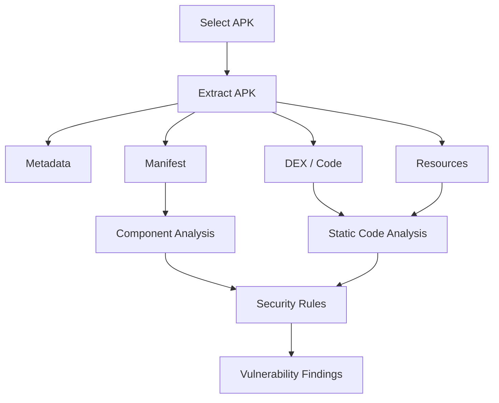

---

# 8. Security Risk Assessment

The **Security Risk Assessment** combines findings from the Permission Auditor and APK Security & Vulnerability Scanner to determine the overall security risk of an application or APK.

## Risk Factors

The assessment can consider:

- Number of sensitive permissions.
- Dangerous permissions.
- Special-access permissions.
- Potentially excessive permission combinations.
- Number of detected vulnerabilities.
- Vulnerability severity.
- Exported application components.
- Insecure configurations.
- Other static-analysis findings.

## Risk Levels

The system can categorize results into:

```text
LOW
MEDIUM
HIGH
CRITICAL
```

## Risk Assessment Functions

- Generate an overall risk level.
- Calculate a risk score.
- Identify applications requiring attention.
- Prioritize high-severity findings.
- Display the factors contributing to the risk.
- Associate individual findings with their risk contribution.
- Distinguish informational findings from serious vulnerabilities.

## Risk Assessment Flow

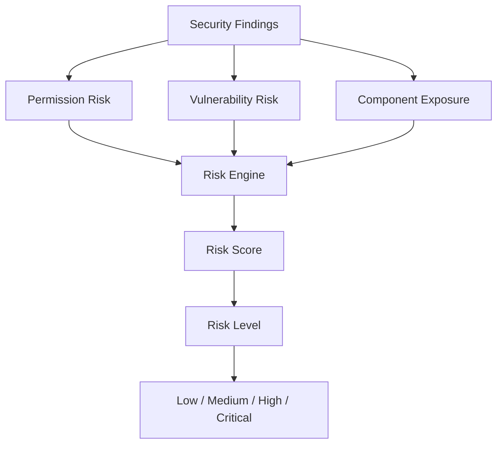

---

# 9. Security Report & Explanation

The **Security Report & Explanation** module converts technical security findings into an understandable report.

Instead of simply displaying a security score, APVM explains the findings and their potential impact.

## Report Information

### Application Information

- Application name.
- Package name.
- Version.
- APK information.
- Scan date and time.

### Permission Findings

- Requested permissions.
- Dangerous permissions.
- Special permissions.
- Potentially excessive permissions.
- Permission-related explanations.

### Vulnerability Findings

- Vulnerability name.
- Affected component.
- Severity.
- Evidence.
- Security impact.
- Recommended mitigation.

### Risk Summary

- Overall risk score.
- Overall risk level.
- Major contributing factors.
- High-priority findings.
- Security summary.

## Explanation Functions

The system explains:

- What was detected.
- Why it matters.
- What security risk it may create.
- Which component is affected.
- What can be done to mitigate the issue.

## Report Flow

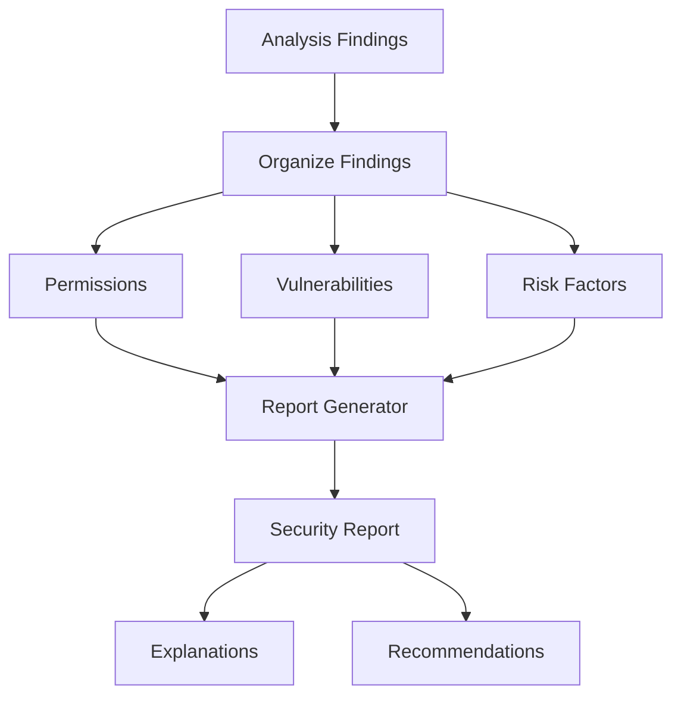

## Implementation & Technical Integration

The **Security Report & Explanation** module is fully implemented with:

- **Interactive Telemetry Gauge**: High-precision circular score visualization (`0-100`) with animated sweep, real-time risk severity pill badges (`LOW`, `MEDIUM`, `HIGH`, `CRITICAL`), and posture narrative.
- **Dynamic Severity Filtering**: One-tap interactive filter chips (`CRITICAL`, `HIGH`, `MEDIUM`, `LOW`, `ALL`) allowing instant filtering of vulnerability findings.
- **Modular Tabbed Architecture**:
  - `FINDINGS`: Expandable cards featuring raw manifest/code evidence, CVSS attack impact, and developer mitigations.
  - `PERMISSIONS`: Dangerous runtime permissions and flagged privilege escalation combinations.
  - `ATTACK SURFACE`: Visual exposure breakdown across exported Activities, Services, Broadcast Receivers, and Content Providers.
  - `REMEDIATION`: Prioritized step-by-step developer hardening roadmap.
- **Android System Sharesheet Export**: Native `Intent.ACTION_SEND` integration serializing full security audits into formatted Markdown/plain text reports for sharing.
- **Cross-Module Deep-Linking**:
  - Direct transition from APK Scanner after scan completion.
  - Instant report generation from Risk Assessment target audit.
  - Full audit reconstruction from persistent Room Scan History records.
  - Direct routing from Dashboard and Bottom Navigation Bar.

---

# 10. Scan History

The **Scan History** module stores previous APK security scans and allows users to review previous results.

It provides a chronological record of security assessments.

## Features

- Record previously scanned APKs.
- Store APK/application name.
- Store package name.
- Store scan date and time.
- Store scan result.
- Store detected vulnerabilities.
- Store permission-related findings.
- Store overall risk level.
- View previous scan details.
- Compare repeated scans.
- Identify changes between repeated scans.
- Delete old scan records.
- Maintain a chronological list of security assessments.

## Scan History Flow

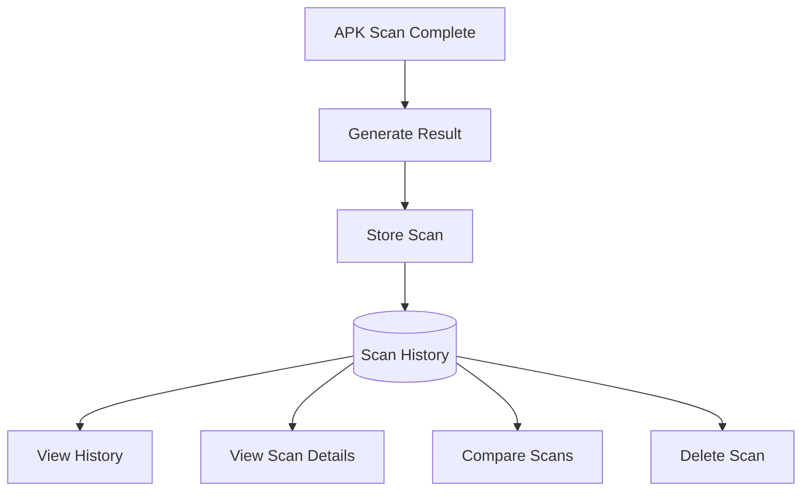

---

# 11. Overall Data Flow Diagram

The overall data flow of APVM connects application information, process monitoring, permission analysis, APK scanning, risk assessment, reporting, and scan history.

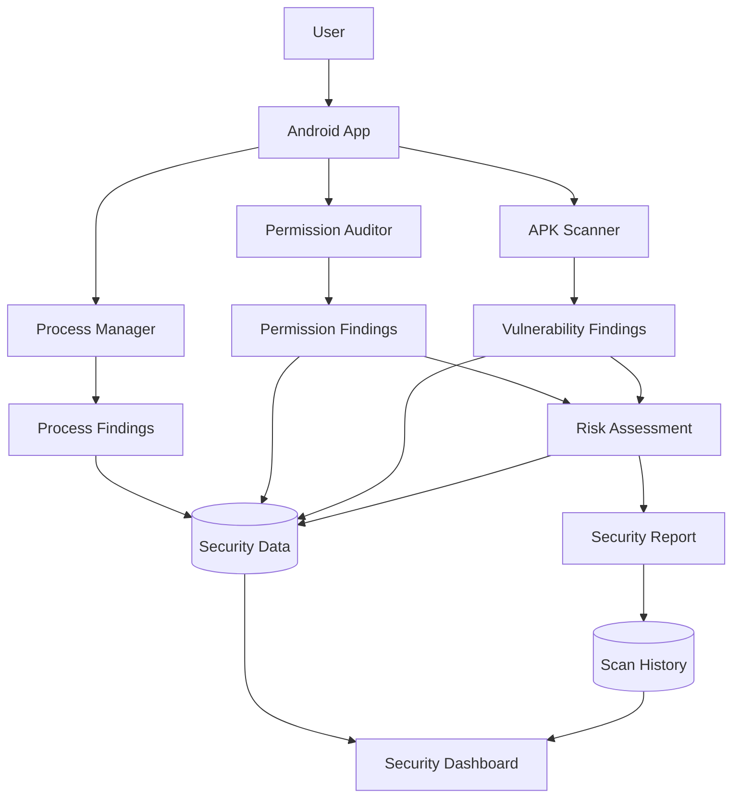

---

# 12. Detailed APK Security Analysis Data Flow

The APK scanning pipeline can be represented as follows:

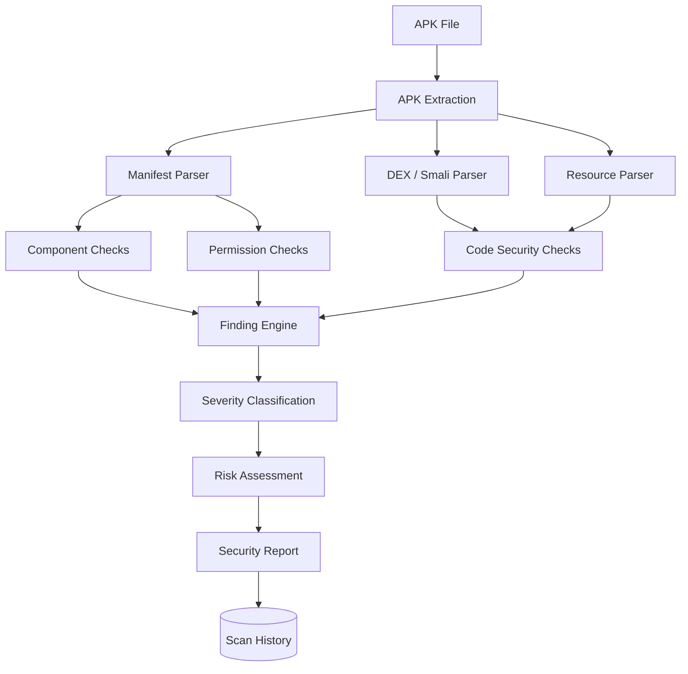

---

# 13. Integrated Application Workflow

The complete user workflow is:

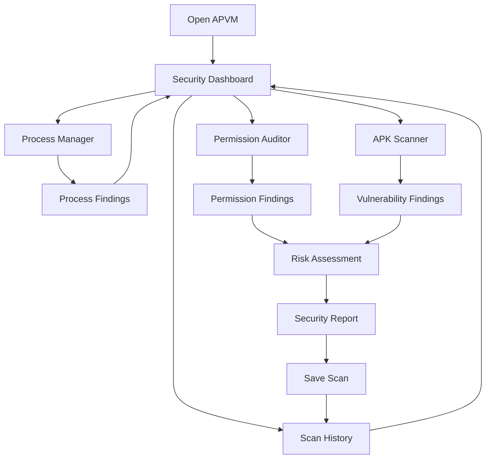

---

# 14. Backend Architecture

The backend provides APIs for communication between the Android application and the security-analysis engine.

## Technology Stack

### Android Client

- Kotlin
- Jetpack Compose
- Material Design
- Android PackageManager
- UsageStatsManager
- Android application/system APIs

### Backend

- Python
- FastAPI
- REST API
- JSON

### APK Analysis

- JADX
- Apktool
- Androguard
- AndroidManifest.xml parsing
- Smali/code static analysis

### Database

- SQLite for local development and prototyping.
- PostgreSQL for production-scale deployment.

## Backend Flow

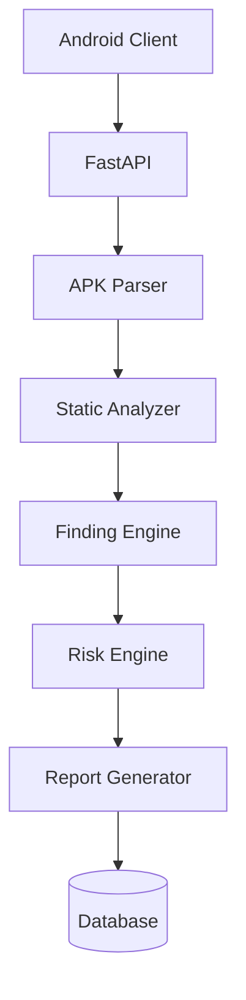

---

# 15. API Structure

The backend can expose the following REST API endpoints:

```text
/api/apps
/api/processes
/api/permissions
/api/upload
/api/analyze
/api/findings
/api/risk
/api/report
/api/history
```

### API Responsibilities

```text
/api/apps
→ Retrieve application information.

/api/processes
→ Retrieve process-related information.

/api/permissions
→ Retrieve permission information.

/api/upload
→ Receive an APK for analysis.

/api/analyze
→ Start APK security analysis.

/api/findings
→ Return detected security findings.

/api/risk
→ Generate or retrieve the security risk assessment.

/api/report
→ Generate the security report.

/api/history
→ Store and retrieve previous scan results.
```

---

# 16. Database Architecture

SQLite can be used during development, with PostgreSQL as a potential production database.

## Application Table

```text
APPLICATION
- application_id
- package_name
- application_name
- version
- installed_date
```

## Permission Table

```text
PERMISSION
- permission_id
- permission_name
- permission_category
- risk_level
```

## Application Permission Table

```text
APPLICATION_PERMISSION
- application_id
- permission_id
```

## APK Scan Table

```text
APK_SCAN
- scan_id
- package_name
- apk_name
- scan_timestamp
- risk_level
- risk_score
```

## Vulnerability Table

```text
VULNERABILITY
- vulnerability_id
- scan_id
- vulnerability_name
- affected_component
- severity
- description
- recommendation
```

## Scan History Table

```text
SCAN_HISTORY
- history_id
- scan_id
- timestamp
- result
```

---

# 17. Risk Scoring Model

APVM uses a deterministic, multi-vector weighted scoring model to compute security risks. Category scores range from 0 to 100, clamped at boundary conditions.

### 17.1 Composite Score Formats

**For Standalone APK Scans:**
```text
Overall Score = (Permission Risk × 0.30)
              + (Vulnerability Risk × 0.35)
              + (Component Exposure × 0.20)
              + (Configuration Hardening × 0.15)
```

**For Installed Device Applications:**
```text
Overall Score = (Permission Risk × 0.45)
              + (Component Exposure × 0.35)
              + (Configuration Hardening × 0.20)
```
*(Vulnerability risk is marked as unassessed / null for installed apps unless static DEX inspection has been executed).*

### 17.2 Severity Classification Thresholds

All composite and category scores map directly to standardized severity levels:

| Score Range | Severity Level | Visual Accent | Action Required |
|---|---|---|---|
| **0 – 29** | `LOW` | Vibrant Emerald (`#00E676`) | Baseline hygiene; minimal exposure. |
| **30 – 59** | `MEDIUM` | Amber (`#FFD600`) | Review sensitive privileges and flags. |
| **60 – 79** | `HIGH` | Neon Orange (`#FF9100`) | Attack surface exposure requiring hardening. |
| **80 – 100** | `CRITICAL` | Vivid Crimson (`#FF1744`) | Severe exposure; immediate remediation needed. |

### 17.3 Device-Wide Security Posture

Device posture aggregates risk across installed applications:
```text
Posture Score = (Average App Score + (Critical Count × 4) + (High Count × 2)).coerceIn(0, 100)
```

### 17.4 Handling Unassessed Categories

In accordance with strict audit requirements, unassessed categories (e.g. historical records where individual subscores were not logged) are stored and rendered as `null` ("NOT ASSESSED" / "N/A"), never as false zero or artificial `LOW` risk.

---

# 18. Known Limitations & Scope Boundaries

1. **Static Analysis Scope**: APK scanning inspects `AndroidManifest.xml` components, permissions, and flags, along with bytecode string indicators (WebView usage, `setJavaScriptEnabled`, `addJavascriptInterface`). Full decompilation (Smali/CFG) or taint analysis is outside the scope of on-device processing.
2. **Behavioral Analysis**: APVM does not perform dynamic runtime sandboxing, kernel instrumentation, or memory hooking.
3. **Malware Attribution**: Permission combinations and exported components represent technical attack surface and privilege capabilities. APVM explicitly avoids speculative malware claims (e.g., classifying a package installer as a "Trojan") without confirmed forensic evidence.
4. **Process Control**: Modern Android sandboxing prohibits third-party applications from force-stopping other apps without root access. Process management provides non-invasive telemetry and historical exit diagnostics.

---

# 19. Verification & Unit Testing

The test suite validates deterministic scoring, boundary condition clamping, permission combination rules, and history persistence:

- `PermissionRiskEvaluatorTest`: Validates permission weights, package prefix normalization, combination detection, and boundary clamping.
- `ComponentExposureEvaluatorTest`: Validates component exposure weighting, unprotected provider detection, and score bounds.
- `ConfigurationRiskEvaluatorTest`: Validates debuggable flags, backup settings, cleartext traffic enforcement across SDK targets, and SDK obsoleteness penalties.
- `VulnerabilityRiskEvaluatorTest`: Validates severity factor penalties (28/18/10/4) and clamping at 100.
- `RiskAggregationTest`: Validates composite APK/Installed formulas, severity thresholds, and device posture aggregation.
- `SecurityReportTest`: Validates report serialization, active caching, export generation, and metadata retention.
- `ScanHistoryTest`: Validates Room entity type converters and database roundtrips.

All 30 unit tests execute cleanly via Gradle:
```powershell
.\gradlew.bat testDebugUnitTest
```

---

# 18. Security Finding Structure

Each security finding should contain a consistent structure:

```text
Finding
├── Finding Name
├── Category
├── Severity
├── Affected Application
├── Affected Component
├── Evidence
├── Description
├── Security Impact
└── Recommendation
```

Example:

```text
Finding Name:
Exported Activity

Category:
Component Exposure

Severity:
HIGH

Affected Component:
MainActivity

Evidence:
Activity is exported without appropriate protection.

Security Impact:
Another application may be able to invoke the component.

Recommendation:
Restrict component exposure and apply appropriate access controls.
```

---

# 19. Testing Strategy

APVM should be tested using controlled applications and APKs with different security characteristics.

## Test Case 1 — Normal Application

```text
Input:
Application with standard permissions and secure configuration.

Expected Result:
Low-risk or informational findings.
```

## Test Case 2 — Dangerous Permissions

```text
Input:
Application requesting multiple dangerous permissions.

Expected Result:
Permission warnings and increased permission risk.
```

## Test Case 3 — Special Permissions

```text
Input:
Application requesting special-access permissions.

Expected Result:
Special-permission findings.
```

## Test Case 4 — Exported Components

```text
Input:
APK containing exposed activities/services/receivers/providers.

Expected Result:
Component exposure findings.
```

## Test Case 5 — Insecure WebView

```text
Input:
APK containing an insecure WebView configuration.

Expected Result:
Static-analysis security finding.
```

## Test Case 6 — Multiple Vulnerabilities

```text
Input:
APK containing several security weaknesses.

Expected Result:
Multiple findings and a higher overall risk level.
```

## Test Case 7 — Repeated Scan

```text
Input:
Same APK scanned multiple times.

Expected Result:
Results stored separately and available for comparison.
```

## Automated Unit Test Execution & Verification

The security assessment pipeline is verified by 35 automated JVM unit tests executing via Gradle:

```bash
./gradlew testDebugUnitTest
```

| Test Suite | Tests | Status | Focus Areas |
|---|---|---|---|
| `SecurityReportFindingsTest` | 5 | PASSED | Provenance, evidence accuracy, factual impact, and non-generic mitigations |
| `PermissionRiskEvaluatorTest` | 7 | PASSED | Dangerous/special permissions, combinations, threshold scoring, penalty caps |
| `ComponentExposureEvaluatorTest` | 6 | PASSED | Exported components, permission protection, boundary capping |
| `ConfigurationRiskEvaluatorTest` | 6 | PASSED | Debuggable, allowBackup, cleartext traffic by target SDK, SDK thresholds |
| `VulnerabilityRiskEvaluatorTest` | 6 | PASSED | DEX strings, library CVE heuristics, scoring caps |
| `RiskAggregationTest` | 5 | PASSED | Weighted composite aggregation, critical override, severity boundaries |
| **Total** | **35** | **100% Passed** | **Zero failures, zero regressions** |

---

# 20. Implementation Roadmap

| Phase | Duration | Module | Deliverables |
|---|---|---|---|
| Phase 1 | Weeks 1–2 | Security Dashboard + Process Manager | Android project foundation, das
