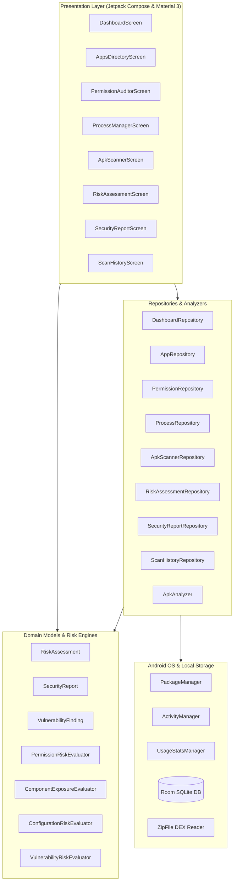
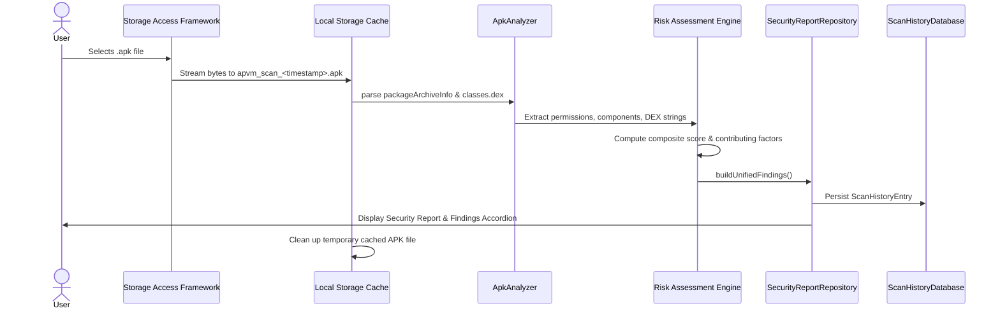

# APVM (Android Process, Permission, and Vulnerability Manager)

## Comprehensive Technical & Feature Guide

---

## 1. Executive Summary & Purpose

**APVM (Android Process, Permission, and Vulnerability Manager)** is a native Android cybersecurity application developed in Kotlin and Jetpack Compose. It serves as an on-device security auditor, static application analysis framework, and runtime observability tool.

### Core Mission

Traditional mobile security utilities are siloed—process managers don't audit permissions, permission managers don't parse APK manifests, and vulnerability scanners rely on remote server uploads that compromise data confidentiality. APVM brings these capabilities into a **100% on-device, zero-network-dependency architecture**. All APK parsing, byte-stream analysis, permission classification, and heuristic risk calculations happen locally in memory.

---

## 2. Technical Stack & Architectural Design

APVM follows **Clean Architecture** and **Modern Android Development (MAD)** standards:



### Technology Matrix

- **Language**: Kotlin 2.2 / JVM 17
- **UI Framework**: Jetpack Compose with Material 3 (Pure Vanilla CSS/Compose, no third-party styling frameworks)
- **Visual Identity**: Cyberpunk Dark Theme
  - Background: Jet Black (`#0A0D14`)
  - Surface: Deep Graphite (`#181F2E`)
  - Cards: Dark Slate (`#121722`)
  - Primary Accent: Cyber Cyan (`#00E5FF`)
  - Subdued Borders: `#222D42`
  - Severity Palette: Low (`#00E676`), Medium (`#FFD600`), High (`#FF9100`), Critical (`#FF1744`)
- **Concurrency**: Kotlin Coroutines (`Dispatchers.IO`, `Dispatchers.Main`) & StateFlow / Flows
- **Local Database**: Room 2.6.1 + KSP2 with TypeConverters (`ScanHistoryConverters`)
- **Bytecode Inspection**: Local `java.util.zip.ZipFile` parsing DEX bytecode string tables
- **Platform Version**: `minSdk = 24` (Android 7.0), `targetSdk = 34` (Android 14)

---

## 3. Detailed Feature-by-Feature Walkthrough

---

### Feature 1: Security Dashboard (`DashboardScreen`)

The Dashboard is the central command center of APVM, providing high-level telemetry and device health indicators.

#### Capabilities

1. **Device Security Posture Gauge**:
   - Evaluates hardware and OS-level security settings to calculate a 0–100 posture score.
   - Checks ADB debugging state via `Settings.Global.getInt(cr, ADB_ENABLED)`.
   - Inspects Developer Options state via `Settings.Global.DEVELOPMENT_SETTINGS_ENABLED`.
   - Checks device lock credential protection via `KeyguardManager.isDeviceSecure()`.
   - Performs heuristic root checks (detecting common root binaries such as `/system/bin/su`, `/system/xbin/su`, and test-keys build tags).
2. **Global Telemetry Metrics**:
   - Total installed applications (system vs user apps).
   - High-privilege and dangerous permissions in active circulation.
   - Real-time running background and foreground application processes.
   - Aggregate vulnerability count.
3. **Quick Navigation Matrix**:
   - Instant routing chips into APK Scanner, Process Manager, Apps Directory, Permission Auditor, and Risk Matrix.
4. **Recent Scans Feed**:
   - Real-time Flow collection from `ScanHistoryRepository`.
   - Displays target name, version, timestamp, severity badge, and score.
   - **Interactive Navigation**: Clicking any recent scan directly reconstructs and displays its complete Security Report.
5. **Lifecycle Awareness**:
   - Automatically polls and updates metrics upon `ON_RESUME` lifecycle events, or on-demand via pull-to-refresh (`PullToRefreshBox`).

---

### Feature 2: Apps Directory (`AppsDirectoryScreen`)

The Apps Directory provides an inventory of all applications residing on the device.

#### Capabilities

1. **Installed Packages Enumeration**:
   - Queries `PackageManager` using `getInstalledPackages(PackageManager.GET_META_DATA)`.
   - Supports `QUERY_ALL_PACKAGES` for system-wide visibility on modern Android platforms.
2. **Filter & Search Controls**:
   - **Search Bar**: Live fuzzy-matching against app name and package namespace (e.g. `com.example.app`).
   - **Type Segment**: Filter between **All Apps**, **User-Installed Apps**, and **System Apps**.
3. **App Metadata Card**:
   - Application Name & Package ID.
   - Version name and version code.
   - Target SDK version (highlighting outdated apps targeting older Android APIs).
   - Application flags (debuggable, system, persistent).
4. **Interactive Actions**:
   - **Inspect Security Posture**: Triggers a deep-dive security risk assessment for the installed package.
   - **Launch App Settings**: Opens the system-level Application Details settings panel (`Settings.ACTION_APPLICATION_DETAILS_SETTINGS`).

---

### Feature 3: Permission Auditor (`PermissionAuditorScreen`)

Audits the distribution of sensitive Android capabilities across all installed software.

#### Capabilities

1. **Dangerous Permissions Classification**:
   - Audits runtime permissions granting access to private user data or hardware:
     - `RECORD_AUDIO` (Microphone access)
     - `CAMERA` (Optical sensor capture)
     - `ACCESS_FINE_LOCATION` & `ACCESS_BACKGROUND_LOCATION` (GPS tracking)
     - `READ_SMS`, `RECEIVE_SMS`, `SEND_SMS` (Telephony & 2FA codes)
     - `READ_CONTACTS`, `WRITE_CONTACTS` (Address book)
     - `READ_CALL_LOG`, `WRITE_CALL_LOG` (Call records)
     - `READ_PHONE_STATE`, `CALL_PHONE` (Telephony hardware)
2. **Special Permissions Classification**:
   - Audits elevated system-level capabilities that bypass standard sandboxing:
     - `SYSTEM_ALERT_WINDOW` (Draw over other apps / overlay)
     - `REQUEST_INSTALL_PACKAGES` (Sideload secondary APKs)
     - `WRITE_SETTINGS` (Modify system settings)
     - `PACKAGE_USAGE_STATS` (Inspect user app activity)
     - `MANAGE_EXTERNAL_STORAGE` (All-files access)
     - `BIND_ACCESSIBILITY_SERVICE` (Accessibility hooks)
     - `BIND_DEVICE_ADMIN` (Device administrator)
3. **Dual Exploration Modes**:
   - **By Permission**: Shows which apps have requested a specific capability (e.g., all 14 apps with microphone access).
   - **By Application**: Shows the full manifest permission surface of a single selected app.

---

### Feature 4: Android Process Manager (`ProcessManagerScreen`)

Provides visibility into active Linux processes, memory consumption, and platform diagnostics.

#### Capabilities

1. **Live Process Enumeration**:
   - Retrieves active application processes via `ActivityManager.getRunningAppProcesses()`.
   - Identifies Process Name, Process ID (PID), and Importance level (Foreground, Visible, Service, Cached).
2. **Memory Diagnostics**:
   - Calls `ActivityManager.getProcessMemoryInfo(pids)` to obtain:
     - Total PSS (Proportional Set Size) in megabytes.
     - Private dirty memory (memory exclusive to the process).
     - Shared dirty memory (shared runtime frameworks).
3. **Foreground Application Detection**:
   - Integrates with `UsageStatsManager.queryUsageStats()` to identify currently active top-level user tasks.
   - Gracefully guides the user to the Usage Access Settings panel if access is not yet granted.
4. **Historical Process Exit Reasons (API 30+)**:
   - On Android 11+, calls `ActivityManager.getHistoricalProcessExitReasons()`.
   - Displays why background processes were terminated (e.g. `REASON_ANR`, `REASON_CRASH`, `REASON_LOW_MEMORY`, `REASON_USER_REQUESTED`).
5. **Platform Constraints & Safety**:
   - Respects Android's Linux UID sandbox boundary: explicitly documents that non-rooted Android prevents arbitrary SIGKILL signals to third-party apps.

---

### Feature 5: APK Security Scanner (`ApkScannerScreen`)

Performs static analysis on uninstalled `.apk` files without executing untrusted code.

#### Workflow



#### What the Scanner Inspects

1. **Application Identity**: App Label, Package Name, Version Name, Version Code, `minSdkVersion`, and `targetSdkVersion`.
2. **Permission Surface**: Complete extraction of all requested permissions (`packageInfo.requestedPermissions`).
3. **Component Exposure Analysis**:
   - Activities: Identifies exported activities and checks for declared permissions.
   - Services: Detects exported services that can be triggered by external intents.
   - Broadcast Receivers: Flags exported receivers vulnerable to spoofed broadcasts.
   - Content Providers: Verifies if exported providers declare both `readPermission` and `writePermission`.
4. **Static DEX Bytecode String Analysis**:
   - Opens the APK as a `ZipFile` and reads `.dex` byte streams (`classes.dex`, `classes2.dex`, etc.).
   - Scans DEX string pools for:
     - `android/webkit/WebView` $\rightarrow$ Flags WebView attack surface.
     - `setJavaScriptEnabled` $\rightarrow$ Detects JavaScript execution in WebViews.
     - `addJavascriptInterface` $\rightarrow$ Detects bridge methods between WebView and Java/Kotlin code.
     - Vulnerable library fingerprints (e.g. vulnerable versions of Log4j, FastJSON, OkHttp).

---

### Feature 6: Security Risk Assessment Engine

The mathematical core that converts raw findings into deterministic risk scores.

#### Evaluator 1: Permission Risk Evaluator (`PermissionRiskEvaluator`)

- **Dangerous Permissions**: Weighted penalties (e.g. `SEND_SMS`: 18 pts, `RECORD_AUDIO`: 15 pts, `CAMERA`: 14 pts).
- **Special Permissions**: System-level penalties (e.g. `BIND_ACCESSIBILITY_SERVICE`: 26 pts, `REQUEST_INSTALL_PACKAGES`: 20 pts).
- **Risky Permission Combinations (9 Rules)**:
  1. _Audio Capture & Network Capability_ (`RECORD_AUDIO` + `INTERNET`) $\rightarrow$ 22 pts (HIGH)
  2. _Camera & Audio Capture with Network Access_ (`CAMERA` + `RECORD_AUDIO` + `INTERNET`) $\rightarrow$ 30 pts (CRITICAL)
  3. _Background SMS Reception Capability_ (`RECEIVE_SMS` + `RECEIVE_BOOT_COMPLETED`) $\rightarrow$ 28 pts (CRITICAL)
  4. _Background Outgoing SMS Capability_ (`SEND_SMS` + `RECEIVE_BOOT_COMPLETED`) $\rightarrow$ 26 pts (CRITICAL)
  5. _Background Geolocation Tracking_ (`ACCESS_FINE_LOCATION` + `ACCESS_BACKGROUND_LOCATION` + `INTERNET`) $\rightarrow$ 24 pts (HIGH)
  6. _Dynamic Package Installation Risk_ (`REQUEST_INSTALL_PACKAGES` + `INTERNET`) $\rightarrow$ 25 pts (HIGH)
  7. _Overlay & Accessibility Privilege Combination_ (`SYSTEM_ALERT_WINDOW` + `BIND_ACCESSIBILITY_SERVICE`) $\rightarrow$ 32 pts (CRITICAL)
  8. _Contacts & Device Identifier Access_ (`READ_CONTACTS` + `READ_PHONE_STATE` + `INTERNET`) $\rightarrow$ 20 pts (HIGH)
  9. _Call Log & Telephony Monitoring_ (`READ_CALL_LOG` + `READ_PHONE_STATE` + `INTERNET`) $\rightarrow$ 18 pts (HIGH)
- **Excessive Sensitive Permissions**: Additional 15 pts if an app requests $\ge 6$ dangerous permissions.

#### Evaluator 2: Component Exposure Evaluator (`ComponentExposureEvaluator`)

- Unprotected Exported Service: 12 pts each (HIGH)
- Unprotected Exported Broadcast Receiver: 10 pts each (MEDIUM)
- Unprotected Exported Content Provider: 18 pts each (CRITICAL)
- Broad Activity Attack Surface: $(N \times 3)$ pts capped at 25 pts when exported activities $> 3$. (HIGH if $> 8$, MEDIUM if $> 3$).

#### Evaluator 3: Configuration Risk Evaluator (`ConfigurationRiskEvaluator`)

- `FLAG_DEBUGGABLE`: 30 pts (CRITICAL)
- `FLAG_ALLOW_BACKUP`: 12 pts (MEDIUM)
- Cleartext HTTP Permitted: 16 pts (HIGH; triggered by `FLAG_USES_CLEARTEXT_TRAFFIC` or `targetSdk < 28`).
- Outdated Target SDK: 20 pts if $< 28$, 12 pts if $< 31$.
- Outdated Min SDK: 10 pts if $< 23$.

#### Composite Scoring Formulas

For **APK Scans**:

$$
\text{Overall Score} = \text{round}(0.35 \times \text{PermScore} + 0.30 \times \text{CompScore} + 0.20 \times \text{VulnScore} + 0.15 \times \text{ConfigScore})
$$

For **Installed Apps** (without static DEX access):

$$
\text{Overall Score} = \text{round}(0.45 \times \text{PermScore} + 0.35 \times \text{CompScore} + 0.20 \times \text{ConfigScore})
$$

**Critical Floor Override**: If any individual category evaluates to `RiskLevel.CRITICAL`, the composite overall score is enforced to be at least `70` (HIGH/CRITICAL range).

#### Severity Ranges

| Score Range  | Severity Label | Color Token        | Security Posture                                         |
| ------------ | -------------- | ------------------ | -------------------------------------------------------- |
| **0 – 29**   | `LOW`          | `#00E676` (Green)  | Standard baseline security; minimal attack surface       |
| **30 – 59**  | `MEDIUM`       | `#FFD600` (Yellow) | Moderate exposure; configurations warrant review         |
| **60 – 79**  | `HIGH`         | `#FF9100` (Orange) | Significant attack surface; sensitive privileges exposed |
| **80 – 100** | `CRITICAL`     | `#FF1744` (Red)    | Severe security threats; immediate remediation required  |

---

### Feature 7: Security Report & Explanation (`SecurityReportScreen`)

Generates human-readable, professional cybersecurity audit reports.

#### Components of the Report

1. **Target Header**:
   - Application Name, Package ID, Scan Type (`APK_FILE` or `INSTALLED_APP`), Timestamp.
   - **Share / Export**: Formats the entire report into Markdown text and dispatches it via Android's `Intent.ACTION_SEND` share sheet.
2. **Executive Summary Card (`ReportSummaryCard`)**:
   - Circular score gauge with animated severity colors.
   - Narrative overview summarizing the exposure posture.
   - **Filter Chips**: Tappable chips showing exact counts of CRITICAL, HIGH, MEDIUM, and LOW findings that dynamically filter the findings list.
3. **Interactive Section Tabs**:
   - **FINDINGS Tab**: Expandable accordion cards (`ReportFindingCard`) displaying:
     - Severity badge (`CRITICAL`, `HIGH`, etc.)
     - Affected component tag
     - Vulnerability Title
     - **Technical Evidence**: Verifiable proof (e.g. `"10 exported activities"`, `"RECORD_AUDIO + INTERNET"`, `"FLAG_DEBUGGABLE == true"`).
     - **Security Impact**: Factual explanation of how the weakness could be exploited.
     - **Recommended Mitigation**: Targeted code-level guidance for developers (e.g. setting `android:exported="false"` or configuring Network Security Config).
   - **PERMISSIONS Tab**: Comprehensive audit of all dangerous and special permissions requested.
   - **ATTACK SURFACE Tab**: Exported component metrics and a list of unprotected components.
   - **REMEDIATION Tab**: Prioritized developer action checklist.

---

### Feature 8: Scan History & Audit Trail (`ScanHistoryScreen`)

Maintains an immutable historical record of all completed security assessments.

#### Capabilities

1. **Room Database Persistence**:
   - Entity: `ScanHistoryEntity` in `ScanHistoryDatabase`.
   - Stores target name, package, version code/name, min/target SDK, composite score, risk level, scan status, duration, and the complete serialized JSON list of findings.
2. **Search & Filter**:
   - Live search by app label or package namespace.
3. **Historical Report Reconstruction**:
   - Clicking a history item rebuilds the exact `SecurityReport` as it was recorded at the moment of scanning.
   - Preserves unassessed category subscores as `null` / `"NOT ASSESSED"` rather than fabricating zero risk.
4. **Record Management**:
   - Swipe or click to delete individual history entries.
   - Clear entire audit trail with a single tap.

---

## 4. Database Schema Reference

The local Room database (`scan_history.db`) manages scan records:

### Table: `scan_history`

| Column           | Type      | Nullable | Description                                  |
| ---------------- | --------- | :------: | -------------------------------------------- |
| `id`             | `INTEGER` | No (PK)  | Auto-incrementing unique scan identifier     |
| `scanType`       | `TEXT`    |    No    | `APK_FILE` or `INSTALLED_APP`                |
| `targetName`     | `TEXT`    |    No    | Human-readable app label                     |
| `packageName`    | `TEXT`    |    No    | Android package namespace                    |
| `versionName`    | `TEXT`    |    No    | Version string from manifest                 |
| `versionCode`    | `INTEGER` |    No    | Numeric version code                         |
| `minSdk`         | `INTEGER` |    No    | Minimum supported Android SDK                |
| `targetSdk`      | `INTEGER` |    No    | Target Android SDK                           |
| `riskScore`      | `INTEGER` |    No    | Computed 0–100 composite risk score          |
| `riskLevel`      | `TEXT`    |    No    | `LOW`, `MEDIUM`, `HIGH`, `CRITICAL`          |
| `status`         | `TEXT`    |    No    | `CLEAN`, `SUSPICIOUS`, `THREAT_DETECTED`     |
| `findingsCount`  | `INTEGER` |    No    | Total count of security findings             |
| `criticalCount`  | `INTEGER` |    No    | Count of CRITICAL severity findings          |
| `highCount`      | `INTEGER` |    No    | Count of HIGH severity findings              |
| `mediumCount`    | `INTEGER` |    No    | Count of MEDIUM severity findings            |
| `lowCount`       | `INTEGER` |    No    | Count of LOW severity findings               |
| `findings`       | `TEXT`    |    No    | JSON-serialized `List<VulnerabilityFinding>` |
| `timestamp`      | `INTEGER` |    No    | Epoch millisecond scan timestamp             |
| `scanDurationMs` | `INTEGER` |    No    | Scan execution time in milliseconds          |

---

## 5. Security Rules & Risk Engine Reference

### Dangerous & Special Permission Weights

| Permission Name              | Category  | Risk Level | Score Penalty |
| ---------------------------- | --------- | :--------: | :-----------: |
| `BIND_DEVICE_ADMIN`          | Special   | `CRITICAL` |    28 pts     |
| `BIND_ACCESSIBILITY_SERVICE` | Special   | `CRITICAL` |    26 pts     |
| `REQUEST_INSTALL_PACKAGES`   | Special   |   `HIGH`   |    20 pts     |
| `SYSTEM_ALERT_WINDOW`        | Special   |   `HIGH`   |    18 pts     |
| `MANAGE_EXTERNAL_STORAGE`    | Special   |   `HIGH`   |    18 pts     |
| `SEND_SMS`                   | Dangerous |   `HIGH`   |    18 pts     |
| `RECEIVE_SMS`                | Dangerous |   `HIGH`   |    16 pts     |
| `READ_SMS`                   | Dangerous |   `HIGH`   |    16 pts     |
| `RECORD_AUDIO`               | Dangerous |   `HIGH`   |    15 pts     |
| `CAMERA`                     | Dangerous |   `HIGH`   |    14 pts     |
| `CALL_PHONE`                 | Dangerous |   `HIGH`   |    14 pts     |
| `ACCESS_FINE_LOCATION`       | Dangerous |  `MEDIUM`  |    12 pts     |
| `READ_CONTACTS`              | Dangerous |  `MEDIUM`  |    12 pts     |
| `WRITE_CONTACTS`             | Dangerous |  `MEDIUM`  |    12 pts     |
| `READ_PHONE_STATE`           | Dangerous |  `MEDIUM`  |    10 pts     |

### Manifest Configuration Penalties

| Flag / Setting        | Condition                                         |  Severity  | Penalty | Technical Remediation                         |
| --------------------- | ------------------------------------------------- | :--------: | :-----: | --------------------------------------------- |
| `android:debuggable`  | `FLAG_DEBUGGABLE == true`                         | `CRITICAL` | 30 pts  | Set `debuggable false` in release build type  |
| `android:allowBackup` | `FLAG_ALLOW_BACKUP == true`                       |  `MEDIUM`  | 12 pts  | Set `android:allowBackup="false"` in manifest |
| Cleartext Traffic     | `FLAG_USES_CLEARTEXT_TRAFFIC` or targetSdk $< 28$ |   `HIGH`   | 16 pts  | Enforce TLS in `network_security_config.xml`  |
| Target SDK Obsolete   | `targetSdkVersion < 28`                           |   `HIGH`   | 20 pts  | Target Android 14+ (API 34+)                  |
| Target SDK Legacy     | `28 <= targetSdkVersion < 31`                     |  `MEDIUM`  | 12 pts  | Target Android 14+ (API 34+)                  |
| Min SDK Deprecated    | `minSdkVersion < 23`                              |  `MEDIUM`  | 10 pts  | Increase `minSdkVersion` to $\ge 23$          |

---

## 6. Verification & Automated Test Suites

APVM includes **35 automated unit tests** verifying deterministic scoring, boundary conditions, factual findings, and mitigations:

```bash
# Run the complete unit test verification suite
./gradlew testDebugUnitTest
```

### Verified Test Suites

| Suite Class                      | Test Count | Status | Scope                                                                                                                 |
| -------------------------------- | :--------: | :----: | --------------------------------------------------------------------------------------------------------------------- |
| `SecurityReportFindingsTest`     |     5      | PASSED | Proves finding provenance, technical evidence accuracy, factual impact, and non-generic mitigations across test cases |
| `PermissionRiskEvaluatorTest`    |     7      | PASSED | Dangerous/special permission scoring, 9 risky combos, score capping at 100                                            |
| `ComponentExposureEvaluatorTest` |     6      | PASSED | Exported components, permission checks, broad activity surface calculations                                           |
| `ConfigurationRiskEvaluatorTest` |     6      | PASSED | Debuggable, allowBackup, cleartext by targetSdk, min/target SDK boundaries                                            |
| `VulnerabilityRiskEvaluatorTest` |     6      | PASSED | DEX bytecode strings (WebView, JavaScript interfaces), library CVE heuristics                                         |
| `RiskAggregationTest`            |     5      | PASSED | Composite formulas, critical ceiling overrides, severity boundary cutoffs                                             |

---

## 7. Known Boundaries & Platform Limitations

1. **Static Bytecode Scanning**: APVM parses manifest tables and scans DEX string tables on-device. It does not perform full CFG (Control Flow Graph) execution or dynamic code injection due to Android mobile RAM and battery constraints.
2. **Process Management Sandboxing**: Third-party Android apps cannot kill or hibernate background processes of other UIDs on non-rooted Android 7+. APVM provides observability, memory metrics, and historical exit diagnostics.
3. **Android 11+ Package Visibility**: Full installed app enumeration requires the `QUERY_ALL_PACKAGES` permission in `AndroidManifest.xml`. On Google Play, distribution requires declaring an enterprise or device-security policy exception.
